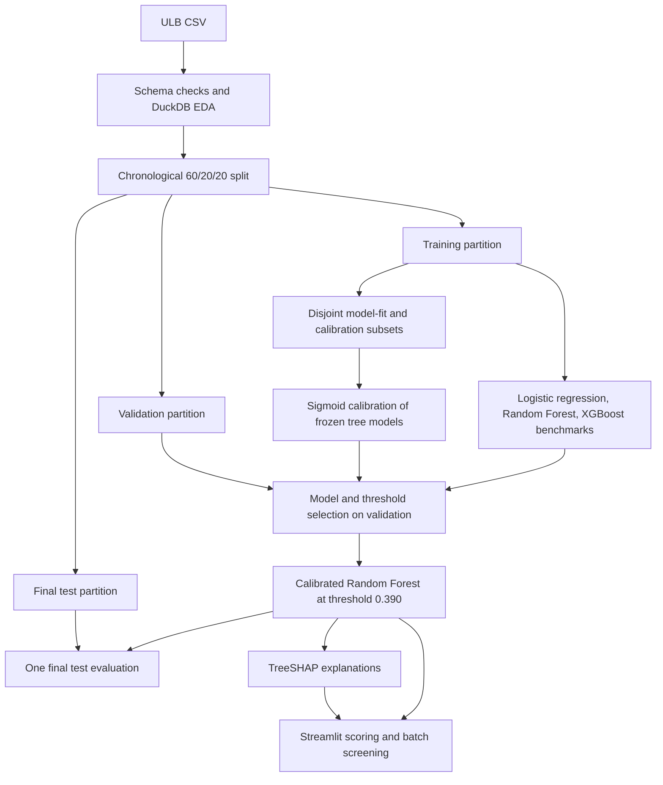

# Fraud Risk Intelligence

An explainable credit card fraud detection **research prototype** built on the [ULB Credit Card Fraud Detection dataset](https://www.kaggle.com/datasets/mlg-ulb/creditcardfraud). It compares three classifiers, calibrates fraud probabilities, and presents review decisions in a four-page Streamlit dashboard.

**Selected model** · Calibrated Random Forest

**Final test average precision** · 0.791712

**Review threshold** · 0.390, selected on validation

**[Hosted dashboard](https://credit-card-fraud-dec.streamlit.app/)** · [Evaluation report](reports/final_test_metrics.json) · [Portfolio notes](reports/portfolio_notes.md)

## Verified results

The frozen model was evaluated once on the final chronological test partition of 56,962 transactions, including 75 fraud cases.

| Final test metric | Result |
| --- | ---: |
| Average precision (PR-AUC) | **0.791712** |
| Precision | **0.898305** |
| Recall | **0.706667** |
| F1-score | **0.791045** |
| ROC-AUC | 0.966213 |
| Brier score | 0.000419 |
| Log-loss | 0.002875 |

| Actual class | No review flag | Review flag |
| --- | ---: | ---: |
| Legitimate | **TN 56,881** | **FP 6** |
| Fraud | **FN 22** | **TP 53** |

Average precision rose from 0.756553 on validation to 0.791712 on final test. At the fixed threshold, precision fell from 0.930233 to 0.898305 and recall rose from 0.701754 to 0.706667. Full-precision values and the model hash are in the [aggregate evaluation JSON](reports/final_test_metrics.json).

## Architecture



The first 60% of transactions formed the training partition. The calibrated RF fit on its earlier 75%, then used the later 25% for sigmoid calibration with `FrozenEstimator`. The next 20% supported benchmarking and threshold selection. The final 20% was scored once after selection. The pipeline robust-scales `Time`, applies `log1p` and robust scaling to `Amount`, and passes V1–V28 through. XGBoost was a benchmark finalist. The calibrated RF was selected for validation F1 and calibration.

Average precision is the primary ranking metric because fraud is rare. The review flag uses calibrated probability ≥ 0.390. Risk tiers are separate display labels: Low below 0.10, Medium from 0.10 to below 0.50, and High from 0.50 upward. TreeSHAP explains the RF output before calibration, so its contributions do not add up to the displayed probability.

## Try the dashboard

The pages are **Data Intelligence**, **Model Performance**, **Fraud Prediction**, and **Batch Screening**. Download the [100-row validation demo CSV](data/demo/validation_transactions_100.csv) from Batch Screening, upload it, and download the scored results. Its 30 numerical features contain no labels. Ten fraud and 90 legitimate validation examples were selected deliberately, so the sample does not represent prevalence. The app uses [compact validation summaries](data/demo/dashboard_summary.json) and a saved calibrated RF artifact. It does not require the full raw dataset.

From a fresh clone, run the dashboard with Python 3.12 from the repository root. The committed calibrated RF and compact demo data support the app without the full ULB CSV:

```bash
python3.12 -m venv .venv
.venv/bin/python -m pip install -r requirements.txt
.venv/bin/python -m streamlit run src/app/dashboard.py
```

Batch Screening accepts anonymized CSVs up to 5 MiB and 5,000 rows. Do not upload card numbers, names, or other sensitive customer data to the public demo.

For Streamlit Community Cloud, choose repository `Saswata2006/Fraud-Risk-Intelligence`, branch `main`, entrypoint `src/app/dashboard.py`, and Python 3.12. The model artifact, demo CSV, summary JSON, and pinned dependencies are tracked. [Streamlit deployment guide](https://docs.streamlit.io/deploy/streamlit-community-cloud/deploy-your-app/deploy)

## Data and reproducibility

The [ULB dataset](https://www.kaggle.com/datasets/mlg-ulb/creditcardfraud) has 284,807 transactions and 492 fraud cases. The original CSV is excluded from Git. From a fresh clone, run the dataset-independent tests with the committed demo bundle:

```bash
.venv/bin/python -m pytest -q -m "not dataset"
```

To run the full research test suite or regenerate reports, obtain `creditcard.csv` from the linked dataset and place it in `data/raw/`, then run `.venv/bin/python -m pytest -q`. Tests marked `dataset` require that file and some also use local Day 1–4 model artifacts. The [final evaluation script](src/models/final_evaluation.py) guards against overwriting the existing test report; the final test set should not be rescored for model selection. GitHub Actions runs the dataset-independent command on Python 3.12.

**Stack** · Python 3.12, Pandas, NumPy, DuckDB, scikit-learn, XGBoost, SHAP, Plotly, Streamlit, Matplotlib, Joblib, and Pytest.

## Limitations

This is a research prototype based on anonymized features from roughly two days of transactions. The short window, 75 positive test cases, and lack of external validation limit generalization claims. Exploratory review costs are illustrative assumptions, not measured savings. Review flags and tiers do not execute payment holds or analyst workflows. The demo sample must not be used to estimate prevalence or performance. Earlier EDA and duplicate audits inspected the full dataset; model fitting, calibration, and selection used their designated partitions. The project has no production monitoring, access control, or regulatory validation.

Dashboard screenshots are pending. The capture list is in [portfolio notes](reports/portfolio_notes.md). Generated [EDA and model figures](reports/figures/) remain available.

The hosted dashboard currently redirects unauthenticated visitors to Streamlit sign-in. Review its sharing settings before using the link in an application.

This repository currently has no `LICENSE` file. Reuse terms for the project code have not been granted, and use of the ULB dataset is subject to its source terms. Add a code license only after the repository owner chooses one and reviews the dataset terms separately.
